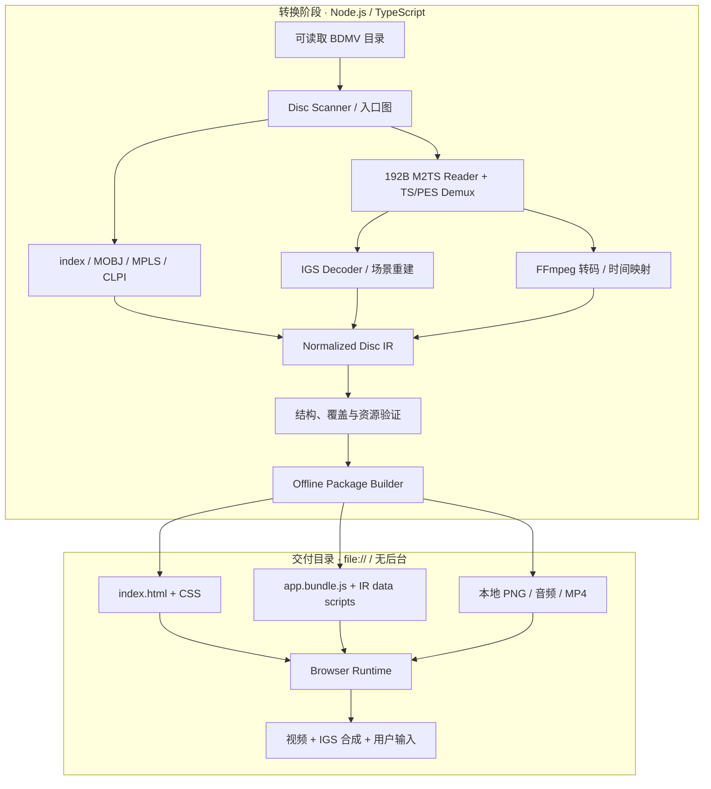
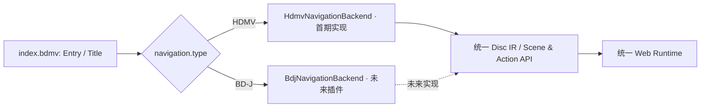
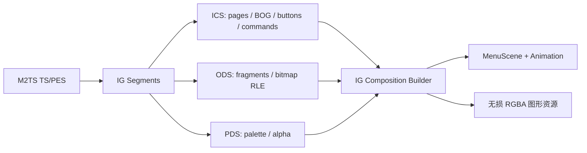

# BDMV HDMV 菜单提取与离线 HTML 复现工具——详细技术设计方案

> 文档版本：v1.0（2026-11-02）  
> 技术路线：**TypeScript 全栈实现；首期仅执行 HDMV；保留 BD-J 扩展接口；导出物为完全自包含的离线 Web 目录**。  
> 项目暂定名：`bdmv-web`  
> 文档性质：可供技术选型、研发拆分、实现与验收使用的设计基线。本文中的 TypeScript 接口、目录与命令均为**拟议设计**，不表示已经完成实现。

---

## 0. 执行摘要与不可变约束

项目不是根据特定碟片截图制作菜单，而是通用的 **BDMV 解析器 → HDMV 语义还原 → 图像/音视频资源导出 → 独立浏览器执行程序**。

必须满足：

1. **通用性**：对符合支持范围的 HDMV 碟片，不编写碟片特定逻辑；解析完整的入口、MovieObject、PlayList、IGS 和媒体引用关系。
2. **开发技术**：转换器及浏览器 Runtime 均以 **TypeScript** 为主；转换器运行于 Node.js，浏览器运行的是预构建的 JavaScript；禁止把 Rust/C/JVM/WASM 作为输出物运行的前置条件。
3. **纯离线交付**：转换产物是一个完整目录，含 HTML、JS、CSS、图像、音频、视频、结构化数据，**不调用外部网址、CDN、API，不安装依赖，不启动 HTTP 服务，不读取原始 BDMV**。
4. **直接打开**：默认交付模式以双击 `index.html`、`file://` 打开为验收目标。针对浏览器本地文件安全策略、媒体自动播放的差异要在构建和验收阶段主动处理；不承诺跨任何浏览器、任何安全设置无条件运行。
5. **行为复现**：保持 HDMV 指令、寄存器、按钮状态、焦点、跳转、播放控制和时间触发的语义，不靠图片 OCR/按钮文字猜测功能。
6. **保真优先**：菜单图片、坐标、按钮状态与时间轴以原始资料为基准；对音视频不得以原始格式恰好可被某浏览器播放作为前提。
7. **BD-J 留接口不实现**：可识别和报告 BD-J 类型及其位置，独立保留 `NavigationBackend`/`MenuProvider` 等抽象；首期**不执行 BD-J、不转译 Java、也不生成假冒的 BD-J 菜单**。
8. **失败可诊断**：不支持的命令、媒体、入口与资源必须进入报告；`strict` 模式下禁止把行为不完整的产物标记为“转换成功”。
9. **不内置解密**：以可合法读取的解保护 BDMV 目录为输入，不将 AACS/BD+ 破解作为项目能力。

### 0.1 关键现实边界

- **“不依赖后台服务”是对导出物的要求，不是对转换阶段的要求。** 转换时允许 Node.js 和本机 FFmpeg/FFprobe 进行解析、解复用、转码；导出后它们都不再需要。
- **完全自包含 ≠ 一个单独的 HTML 文件。** 推荐 `index.html + app.js + assets/` 的目录式交付，复制整个目录即可离线使用。
- **浏览器并不提供蓝光播放器的全部原语。** 尤其无缝分支、多角度、全部原声音轨/字幕、复杂辅助视频及不同浏览器的媒体编解码实现，必须分类定义“精确保真”“等效替代”“暂不支持”。
- **有声媒体首次自动播放常被浏览器拒绝。** 可在首次打开时要求点击“开始”，不以此视为需要后台；`video.play()` 必须处理 `NotAllowedError`。
- **要完整执行“播放正片/章节”等操作，就必须把它们所需的音视频一并输出。** 只输出菜单素材的 `menu-only` 模式属于预览/分析模式，不应标注为完整功能输出。

---

## 1. 目标、范围与输出模式

### 1.1 首期范围（HDMV）

| 编号 | 功能 | 优先级 | 实现要求 |
|---|---|---|---|
| F-01 | 读取 BDMV 目录 | P0 | 自动识别根目录及 BACKUP 兜底来源，验证文件和引用完整性 |
| F-02 | 导航入口解析 | P0 | `index.bdmv` 的 First Play、Top Menu、Title 与 HDMV/BD-J 类型 |
| F-03 | 电影对象解码 | P0 | `MovieObject.bdmv` 指令记录、反汇编、控制流与源位置 |
| F-04 | 播放列表解析 | P0 | `MPLS` PlayItem、Mark、STN、SubPath 与 Clip 引用 |
| F-05 | Clip 与传输流识别 | P0 | `CLPI` 和 `M2TS` PID、时间戳、IG/音视频轨道 |
| F-06 | IGS 完整提取 | P0 | ICS/PDS/ODS、分段对象重组、RLE、调色板、页面/BOG/按钮/动画 |
| F-07 | 菜单音效提取 | P1 | `sound.bdmv` 转换为可直接播放的音频文件 |
| F-08 | HDMV VM 执行 | P0 | GPR/PSR、分支比较、算术/位操作、系统命令、导航调用与恢复 |
| F-09 | 交互菜单呈现 | P0 | Normal/Selected/Activated、方向键、确认、鼠标、页面切换 |
| F-10 | HDMV 播放协同 | P0 | 播放列表切换、章节、返回、菜单、时间事件、播放结束 |
| F-11 | 动态菜单与 Pop-up | P1 | 背景视频循环、IG 时效、播放时叠加菜单、音效和效果 |
| F-12 | 离线导出 | P0 | 无网络、无后台、无依赖安装、无需原始 BDMV |
| F-13 | 自动验证 | P0 | 资源完整性、指令覆盖、路径可达性、`file://` 冒烟测试 |
| F-14 | 对照测试与调试 | P1 | VM Trace、资源溯源、截图/状态比较、错误定位 |
| F-15 | BD-J 扩展槽 | P0（接口） | 能识别、保留元数据、声明 unsupported、预留未来后端 |

### 1.2 不在首期实施的功能

- BD-J Xlet 执行、JVM、Java 反编译/转译、BD-J 图形渲染。
- BDMV 反向写回、Blu-ray 制作/刻录、菜单编辑后生成新光盘。
- AACS/BD+ 解密、DRM 绕过。
- 对所有盘片内容做无条件、不可证明的 100% 兼容承诺。
- 必须运行在服务器上的在线播放器、动态 API、数据库、云转码、浏览器扩展或本地代理。

### 1.3 两种导出模式

| 模式 | 用途 | 是否完整离线 | 是否完整菜单行为 |
|---|---|---|---|
| `standalone-full`（默认） | 对终端用户交付可交互菜单和关联播放资源 | 是 | 对声明支持且验证通过的 HDMV 子集应完整 |
| `menu-only`（显式选择） | 图形审阅、导航调试、快速查看按钮/页面 | 是 | **否**；播放正片等缺失资源的操作标明 unavailable |

**原则**：不能把 `menu-only` 的“播放按钮弹出提示”描述成完整菜单转换。默认 `standalone-full` 必须把可到达且需要播放的媒体转换并打包；对无法导出的分支严格失败或标记降级。

---

## 2. 现有项目与复用策略

| 项目 | 价值 | 本项目中的定位 |
|---|---|---|
| [libbluray](https://www.videolan.org/developers/libbluray.html) / [API 文档](https://videolan.videolan.me/libbluray/bluray_8h.html) | HDMV 导航事件、IG 图层回调、用户输入、菜单行为 | **开发时参考与对照验证**；不随 Web 包运行 |
| [BDedit](https://bdedit.pel.hu/) | BDMV/IGS 查看、按钮和 MovieObject 指令跟踪、菜单模拟 | **人工核查与故障分析** |
| [igstools](https://github.com/SAPikachu/igstools) | IG 流解码及页面/按钮状态导出 | **IG 提取交叉测试** |
| [libhdmv](https://github.com/liminal-hq/libhdmv) | HDMV 结构、VM、IGS、Scene 的模块划分 | **借鉴规范建模及测试设计**，不使用 Rust 运行依赖 |
| [FFmpeg](https://ffmpeg.org/) / [FFprobe](https://ffmpeg.org/ffprobe.html) | 转码、媒体信息验证、音视频复用 | **仅在转换阶段调用**，输出时不存在依赖 |
| [MDN：file:// 与 CORS](https://developer.mozilla.org/en-US/docs/Web/HTTP/Guides/CORS/Errors/CORSRequestNotHttp) | 本地文件读取受限 | 指导无服务器打包策略 |

**选型判断**：TypeScript 重写解析与执行核心，而非移植整个播放器。第三方 C/Rust 方案主要是对照基线，避免在 Web 端引入原生/WASM 模块。若未来使用第三方代码，应独立审核源码许可、适配工作量和分发条件。

---

## 3. 系统架构



### 3.1 两端独立

- **Converter**：只运行于制品生成机；文件扫描、媒体解析、资源转换、引用修复、代码生成、校验、打包。
- **Browser Runtime**：只依赖标准浏览器提供的 DOM、Canvas、HTMLMediaElement、定时器、键鼠/触摸输入；全部资源来自同目录。
- **Shared Contracts**：TypeScript 类型、Schema 版本、命令枚举、事件协议和资源引用规范由 `packages/core` 共享，但浏览器最终加载的是构建后 bundle。

### 3.2 保留 BD-J 的结构性位置



当前若入口类型为 BD-J，返回 `UNSUPPORTED_NAVIGATION_BACKEND`，报告其 BDJO 引用和受影响入口。**不能**把 BD-J 路径当 HDMV 解析，也不能在 IR 中丢弃该入口。混合型碟片允许导出 HDMV 部分，但整体完成度必须标注 `partial`；默认严格模式不把这种导出宣称为全碟完整。

---

## 4. TypeScript 项目组织

```text
bdmv-web/
├── apps/
│   ├── cli/                     # CLI: inspect/extract/convert/validate
│   └── studio/                  # 可选 Tauri/Electron/Web GUI（非导出物）
├── packages/
│   ├── core/                    # TS 类型、版本、错误码、事件和 IR
│   ├── bdmv-io/                 # 文件系统、路径、防路径穿越、安全读流
│   ├── bdmv-parser/             # index/MOBJ/MPLS/CLPI/sound
│   ├── m2ts-demux/              # 192B packet, 188B TS, PSI/PES, PTS
│   ├── igs-decoder/             # ICS/PDS/ODS, palette, RLE, compositions
│   ├── navigation-hdmv/         # command decoder, registers, VM, state
│   ├── media-export/            # FFmpeg/FFprobe, playlist timeline
│   ├── ir-builder/              # source graph -> unified IR
│   ├── package-builder/         # 离线 Web 打包、资源签名、检查
│   ├── runtime-web/             # TS 编写，构建为 classic JS/IIFE
│   ├── test-fixtures/           # 合成合法小样本、错误输入及 golden
│   └── test-runner/             # VM trace、截图、双击打开测试
├── scripts/
├── docs/
├── package.json
├── pnpm-workspace.yaml
└── tsconfig.base.json
```

建议 Node.js LTS + TypeScript 5.x + pnpm + Vitest；二进制操作使用 `Buffer`、`Uint8Array`、`DataView` 和 `node:fs` 流式读取。Web 构建使用 esbuild/Rollup，**输出 `iife` 或不含 import 的传统脚本**，不向最终包分发 npm 依赖、node_modules、Source Map、Native Addon 或开发工具。

### 4.1 二进制解析通用接口

```ts
export interface BinaryCursor {
  readonly offset: number;
  readonly length: number;
  u8(): number;
  u16be(): number;
  u32be(): number;
  u64be(): bigint;
  bytes(length: number): Uint8Array;
  seek(offset: number): void;
  subview(length: number): BinaryCursor;
}

export interface ParseContext {
  sourceFile: string;
  fileOffset: number;
  strict: boolean;
  report: DiagnosticSink;
}

export interface Parser<T> {
  parse(data: Uint8Array, context: ParseContext): T;
}
```

要求：任何长度、数量、偏移和索引都须边界检查；错误记录 file/offset/objectId/expected/actual；不允许从损坏的长度字段造成无限分配；大文件应尽量分块流式处理。

---

## 5. BDMV 入口与文件关联解析

### 5.1 目录识别和数据来源

```text
BDMV/
├── index.bdmv
├── MovieObject.bdmv
├── PLAYLIST/*.mpls
├── CLIPINF/*.clpi
├── STREAM/*.m2ts
├── AUXDATA/sound.bdmv
├── BDJO/*.bdjo        # 首期只识别引用
├── JAR/*.jar          # 首期不执行/不读取代码语义
└── BACKUP/            # 只作有明确规则的备用读取来源
```

扫描后构建有向引用图：

`DiscEntry → Title(HDMV/BD-J) → MovieObject → PlayList → PlayItem/Clip → M2TS/PID → IG Composition/Button/Asset`。

同时记录不可达但被文件声明的资源；必要时提供 `include-unreachable` 诊断导出。不能仅以文件名排序认定 Top Menu、主影片或菜单所在 Clip。

### 5.2 文件解析责任

| 文件 | 解析重点 | IR 输出 |
|---|---|---|
| `index.bdmv` | 版本、First Play、Top Menu、Title 列表、类型、目标引用 | `DiscEntry[]`, `TitleRef[]` |
| `MovieObject.bdmv` | 对象、Resume/Menu Call 类属性、指令记录 | `HdmvProgram[]` |
| `*.mpls` | PlayItem、IN/OUT、章节 Mark、STN、SubPath | `Playlist[]`, `PlayItem[]`, `Track[]` |
| `*.clpi` | ProgramInfo、CPI/EP map、PTS 与 SPN 索引 | `ClipInfo[]`, `TimeMap[]` |
| `*.m2ts` | TS/PES、IG PID、音视频 PID、PTS/DTS、分包 | `MediaStream[]`, `IgDisplaySet[]` |
| `sound.bdmv` | 声音条目、编码和采样参数 | `SoundEffect[]` |
| `*.bdjo` | 仅记录存在和引用，不执行 | `UnsupportedTitleRef` |

### 5.3 M2TS 解复用流程

1. 识别 Blu-ray 常见 **192 字节源包（4 字节额外包头 + 188 字节 TS）**，校验偏移 4 处的 `0x47` 同步字节；对于非典型输入，检测并报告其它包格式，不盲目按 188 解析。
2. 解析 TS header、adaptation field、连续计数器、payload-unit-start、PAT/PMT，结合 MPLS/CLPI 的流信息辨识 IG/PG/媒体 PID。
3. 按 PID 重组 PES，解析 PTS/DTS、处理时间戳回绕、分段丢失和不连续标记。
4. IG 解析独立于视频帧解码；正确处理跨 PES 的 IGS 段、Display Set 完成事件。
5. 保存源 `clipId/pid/packetOffset/pesOffset/pts`，以便回溯。

**重点**：菜单使用 **IGS**，PGS 主要服务字幕/Presentation Graphics；不应以“提取所有 SUP 字幕”代替 IGS 解析。

---

## 6. IGS 图形、按钮及菜单场景还原

### 6.1 解码流水线



**保存结构化对象，不只保存截图。** 至少包括：

- Composition 数量/版本/时间、页面 ID、默认按钮/页面、按钮有效性及显示条件。
- Button Overlap Group（BOG）、buttonId、坐标/层级、上/下/左/右邻居、自动动作信息。
- `normal / selected / activated` 关联的图像对象、动画帧范围、重复与裁剪。
- ICS 中可执行的按钮命令序列（**与 MovieObject 命令同一执行器**）。
- PDS 调色板中的色彩与 alpha、ODS 的对象编号、版本、尺寸、分片拼接、RLE。
- Palette/窗口/裁剪/进入退出效果及对应 PTS，页面切换和动画完成事件。
- 播放期间被叠加的 Pop-up 菜单，而不是独立视频播放器外的一张静态菜单。

### 6.2 图像解码细则

- 根据规范处理 YCbCr/YCbCrA 转换和 alpha，使用适配的色彩变换；不混用 RGB/A 与索引色。
- 保留原对象及输出 PNG 的映射关系；同一 ODS 与不同 PDS 调色板组合时，必要时产生不同渲染版本。
- ODS RLE 要支持行结束、行长度、透明 run、跨段与异常检测；输出和源图像宽高做校验。
- 状态可能是透明图层、多个图形对象组合或多个帧；**按钮命中区域来自结构化 button 区域，不从图片 alpha 反推**。
- 对文字保持原图形像素，禁止 OCR 后重排为普通 HTML 文本；可选生成无障碍辅助标签。
- 对坐标统一使用 Blu-ray 原始像素空间；渲染时进行等比缩放及指针坐标逆变换。

### 6.3 菜单状态机

```ts
type MenuVisualState = 'normal' | 'selected' | 'activated';

type MenuInput =
  | { type: 'UP' | 'DOWN' | 'LEFT' | 'RIGHT' | 'ENTER' }
  | { type: 'TOP_MENU' | 'POPUP_MENU' | 'RETURN' }
  | { type: 'POINTER_MOVE' | 'POINTER_CLICK'; x: number; y: number }
  | { type: 'TIMER'; clock90k: bigint };

interface MenuSceneState {
  activeCompositionId: string | null;
  activePageId: number | null;
  selectedButtonId: number | null;
  activeButtonId: number | null;
  popupVisible: boolean;
  clock90k: bigint;
}
```

真实实现必须在此基础上增加 BOG 可用性、效果与按钮动画状态、用户操作屏蔽（UO mask）、页面/播放上下文及延迟触发。每一次输入由 `MenuController` 解析成导航事件与重绘请求，不能让具体 HTML 按钮直接执行硬编码的 `play()`。

---

## 7. HDMV 导航指令与虚拟机

### 7.1 指令模型

HDMV 导航记录通常以 **12 字节（3×32 bit）** 为单位，覆盖 Branch / Compare / Set 类别；必须解析立即数标记、GPR/PSR 寄存器操作数、具体操作码、保留位与非法组合。指令可来自 MovieObject，也可来自 IGS 按钮。

```ts
interface HdmvInstruction {
  opcode: string;                  // 枚举化，未知码不得丢失
  group: 'branch' | 'compare' | 'set' | 'unknown';
  operands: Operand[];
  raw: [number, number, number];   // 3 x uint32
  source: {
    file: string;
    offset: number;
    movieObjectId?: number;
    buttonId?: number;
    index: number;
  };
}

type Operand =
  | { kind: 'immediate'; value: number }
  | { kind: 'gpr'; index: number }
  | { kind: 'psr'; index: number };
```

此处是 IR 表示方式，并不替代真实 bit-field 规范。解析层与执行层分离，防止将机器指令强制映射到不完整的“播放/点击/跳转”动作集。

### 7.2 VM 的最小组成

| 组件 | 要求 |
|---|---|
| `RegisterFile` | 按 HDMV 语义维护 GPR 与 PSR，采用明确的 32-bit 位运算、读写权限、初始化策略 |
| `HdmvCommandDecoder` | 12 字节解码、字段校验、反汇编及原始字节保存 |
| `ProgramExecutor` | PC、条件跳过、对象调用栈/返回、逐条执行、暂停与恢复 |
| `NavigationController` | First Play、Top Menu、Title、PlayList、对象间导航 |
| `SystemCommandHandler` | PlayPL/PlayPLatPI/LinkPI、SetStream、SetButtonPage、PopupOff、Still 等能力映射 |
| `PlaybackBridge` | 接受虚拟机的媒体请求、异步执行、把结果/事件写回状态 |
| `TraceRecorder` | 记录执行前后寄存器、PC、指令、事件、资源状态及异常 |

**重要语义**：有些 Compare 指令控制的是下一条指令的条件执行，不能统统编译成普通页面路由；跨对象 Jump/Call/Resume 与播放结束回调也必须保持相应栈语义。GPR/PSR 的位宽、数量、默认值和读写规则应以参考实现及规范验证，不以任意初始全 0 代替。

### 7.3 Action/Event 协议

```ts
type NavigationAction =
  | { type: 'PLAY_PLAYLIST'; playlistId: string; playItemId?: number }
  | { type: 'SEEK_TIME'; time90k: bigint }
  | { type: 'SEEK_CHAPTER'; chapterId: number }
  | { type: 'SELECT_TRACK'; kind: 'audio' | 'subtitle'; streamId: number }
  | { type: 'SET_MENU_PAGE'; pageId: number; buttonId?: number }
  | { type: 'SET_POPUP_VISIBLE'; visible: boolean }
  | { type: 'PLAY_SOUND'; soundId: string }
  | { type: 'STILL'; enabled: boolean; seconds?: number }
  | { type: 'RESUME' }
  | { type: 'STOP_PLAYLIST' };

type RuntimeEvent =
  | { type: 'MEDIA_STARTED'; playlistId: string }
  | { type: 'PLAYITEM_CHANGED'; playItemId: number }
  | { type: 'MEDIA_ENDED'; playlistId: string }
  | { type: 'TIME_UPDATED'; time90k: bigint }
  | { type: 'MEDIA_ERROR'; code: string }
  | { type: 'USER_INPUT'; input: MenuInput };
```

以上动作仅是 **领域层 API 示例**；完整操作码及特殊条件必须在实现清单中逐项映射，不可因为此处未列出就直接忽略（例如各类跳转、用户操作限制、流控制、系统寄存器操作）。

### 7.4 执行调度

1. 从 `DiscEntry` 执行 First Play 对应 HDMV MovieObject。
2. VM 同步执行可立即完成的指令；遇到播放、等待媒体、仍帧或其它异步动作时生成 Action 并挂起。
3. `PlaybackBridge` 用浏览器 `<video>` 完成操作，按媒体时间回送 `RuntimeEvent`。
4. `NavigationController` 依据事件继续 VM、跳转下一个 PlayItem，或完成菜单效果。
5. 所有播放命令、寄存器变更、按钮状态切换进入同一调试 Trace，保证可复现。

防护：单轮 VM 指令预算、异步事件队列深度、重复跳转检测、时间/资源上限；触发限制时必须报告 `VM_EXECUTION_LIMIT` 而不是静默“成功”。

---

## 8. 播放列表、媒体与时间轴：离线等效的重点

### 8.1 时间基准

建立统一的 `DiscTime90k = bigint` 表示，转换 `CLPI/MPLS/IGS` 内不同来源的时间基准，并保存 `sourceTimebase`。45 kHz 类型时间转换到统一 90 kHz 时按规范乘 2；不要直接混用 PTS、播放器 `currentTime`、PlayItem 的 IN/OUT、章节的相对时间。

`mediaTimeSec = (disc90k - segmentDiscStart90k) / 90000 + exportedSegmentOffsetSec`

由于多 PlayItem、剪辑和重新编码可能带来起始 PTS 变化，必须由 `MediaTimelineMap` 显式维护对照，而不能单靠视频文件名或播放时长。

### 8.2 媒体导出策略

**默认优先**：为了支持原生 `<video src>` 在 `file://` 下直接打开，转换阶段导出浏览器广泛支持的 **MP4(H.264 + AAC)**；原始 MPEG-2/VC-1、DTS、TrueHD 等不得直接作为唯一输出。音效为 WAV，图片为 PNG。

- 对每个真实可到达的 HDMV 播放路径计算需要的 Playlist / PlayItem / Track。
- 对单一路径可预合成为 MP4 时，使用预合成以降低 PlayItem 切换导致的缝隙。
- 对分支路径或可交互时间点，按节点输出多个可独立索引的媒体，保存每段映射与事件点；需要时预导出不同播放变体。
- 写入 MP4 `moov` 等浏览器需要的索引信息（例如 `+faststart`），确保本地定位可用。
- 对媒体片段边界做时间戳校准，避免 IG/声音/章节和画面错位。
- 转码时记录画面比例、色域、帧率、时间戳变化；HDR→SDR 必须明确是否做 Tone Mapping。
- 体积较大的完整正片可能占据数十 GB；“自包含”意味着这些文件需要随目录提供，不能从光盘或网络按需引用。

### 8.3 音轨与字幕的技术局限

**音轨**：浏览器对 MP4 多音轨的脚本切换支持不一致。首期应明确选择：对声明支持的音轨输出可切换的本地媒体变体，切换时保持逻辑时间映射；如果要求真正无缝、毫秒级同步切音，需有专项研发与逐浏览器验证。不可默认 `video.audioTracks` 在所有浏览器有效。

**字幕**：若目标是复现蓝光图形字幕，应将所需 PGS 时间片与位图转换成浏览器图层，同步 `currentTime`；不能直接把位图字幕误写成 WebVTT 文本。字幕轨道选择与 PSR 更新需要闭环。

**高级特性**：无缝分支、多角度、复杂 PiP/辅助视频、非常规流切换不在没有专项验证前宣布完整支持。在 `strict` 模式下，若这些特性会影响可达菜单行为或播放操作，必须失败或以明确降级配置及报告呈现。

---

## 9. 纯离线 HTML 的专用打包规范（最重要）

### 9.1 为什么不能直接使用常见 SPA 打包方式

浏览器直接双击打开 `file:///.../index.html` 时，本地文件往往采用不透明来源（opaque origin）。以下方案**不允许成为默认方案**：

- `fetch('./menu-ir.json')` / `XMLHttpRequest` / runtime JSON 文件请求。
- `<script type="module">`、动态 `import()`、模块分包运行时加载。
- Service Worker、需要 HTTP 头的 WASM 流式加载、在线字体/CDN、远程分析埋点。
- MediaSource 通过 `fetch` 拉本地媒体并进行 JS 拼接作为唯一播放路径。
- 浏览器内执行 FFmpeg、Node.js、Tauri API、Rust/C 原生扩展。

这些方式不应被误当作 `file://` 一定可用。参考 MDN 关于 [本地文件 CORS](https://developer.mozilla.org/en-US/docs/Web/HTTP/Guides/CORS/Errors/CORSRequestNotHttp) 和 [JavaScript Modules](https://developer.mozilla.org/en-US/docs/Web/JavaScript/Guide/Modules) 的限制。

### 9.2 默认 Portable Offline Profile

1. **JS**：构建为浏览器**经典脚本**（IIFE，ES2020 目标），最终 HTML 通过 `<script defer src="./runtime/app.bundle.js"></script>` 引入，无 import/export、无需 MIME 模块类型。
2. **IR/清单**：构建时生成 `window.__BDMV_BOOTSTRAP__ = {...}` 的传统 JS 数据脚本，或把 JSON 安全嵌入 `<script type="application/json" id="disc-data">...</script>`，运行时用 DOM `textContent` 解析；**不用 fetch**。嵌入 JSON 必须安全转义 `</script>`、`<` 等防注入内容。
3. **IGS**：强离线兼容配置建议将小型菜单 PNG 图集按批次嵌入 `assets-data-*.js`（base64/data URL）或运行时预加载并建立 `HTMLImageElement`；对 Canvas 绘制与本地文件源策略需在目标浏览器矩阵检验。可以另提供外链 PNG 的 `compact` 优化包，不能未经测试直接取代兼容档。
4. **CSS/字体**：使用内联 CSS 或相对路径普通 `<link rel="stylesheet">`；禁止外部字体、第三方图标 API。
5. **媒体**：`<video src="./assets/media/xxx.mp4">` / `<audio src="./assets/sound/xxx.wav">` 使用同目录相对路径；不使用 `fetch` 读取视频字节；转码结果必须浏览器可播放。
6. **启动**：HTML 完成脚本与数据加载后在 UI 显示“开始”交互层；若浏览器允许静音背景自动播放，可用静音先展示，否则待用户手势后播放有声内容。
7. **安全**：没有网络通信、没有 `eval`、没有用户源 HTML 动态注入；文件名及 JSON 字符串须转义，资源路径采用相对路径，不含源磁盘绝对路径。
8. **生命周期**：刷新页面从 First Play 或配置的稳定入口恢复；需要保存播放点时只做显式可选功能，不能依赖 `file://` 下 `localStorage` 可用性。

### 9.3 输出目录

```text
my-disc-web/
├── index.html                       # 双击启动
├── runtime/
│   ├── app.bundle.js                # 离线 Runtime，经典脚本
│   ├── disc-data.js                 # IR/metadata，JS 注入数据
│   └── assets-data-000.js           # 可选，内嵌交互图层资源
├── assets/
│   ├── graphics/                    # 已转换 PNG / 可选图集
│   ├── backgrounds/                 # 背景视频及静态帧
│   ├── media/                       # 完整播放链路所需 MP4
│   ├── audio/                       # 按钮音效、其它音频
│   └── subtitles/                   # 可选 PG 图形字幕与时间表
├── reports/
│   ├── compatibility.json           # 完成度、覆盖、降级记录
│   ├── dependency-audit.json        # 无外部资源检查
│   └── asset-manifest.json          # 资源 HASH/大小/原文件映射
└── README.txt                       # 双击说明、浏览器兼容提示
```

**资源唯一性约束**：所有 `src`/`href`、脚本数据、CSS URL 解析后的路径，只能在本目录内；禁止 `http(s)://`、`//hostname`、`file:///原始碟片`、`../` 越界和所有 `data` 中的外网引用。检查时应解析 URL，不是只靠字符串 grep。

### 9.4 `index.html` 示意

```html
<!doctype html>
<html lang="zh-CN">
<head>
  <meta charset="utf-8">
  <meta name="viewport" content="width=device-width, initial-scale=1">
  <title>BDMV Menu</title>
  <style>html,body{margin:0;background:#000;color:#fff}</style>
  <script defer src="./runtime/disc-data.js"></script>
  <script defer src="./runtime/assets-data-000.js"></script>
  <script defer src="./runtime/app.bundle.js"></script>
</head>
<body>
  <div id="bdmv-app" role="application" aria-label="Blu-ray menu"></div>
  <video id="bdmv-video" playsinline preload="metadata"></video>
  <audio id="bdmv-sfx" preload="auto"></audio>
</body>
</html>
```

这个 HTML 仅说明依赖装载方式，实际渲染需要给 `<video>` 绝对定位和正确 z-index，并创建 Canvas/交互层；`disc-data.js`、`assets-data-000.js` **必须由生成器实际产生**。

### 9.5 `file://` 浏览器验收矩阵

首期至少验证：Windows Chrome / Edge、macOS Chrome / Safari、Firefox（各选择一个锁定的支持版本）。测试结果按版本记录，不以“开发者电脑可双击打开”代表跨平台通过。

| 能力 | 验收方式 |
|---|---|
| HTML 直接打开 | **关闭网络**，从文件管理器双击 `index.html`，控制台没有 CORS/资源异常 |
| 加载脚本、IR | 无 HTTP、本地服务、Node 环境，首屏正确显示 |
| 加载图形 | Normal/Selected/Activated、透明度与坐标正确；无 Canvas 安全异常 |
| 有声播放 | 先点击“开始”，按钮音效和视频音轨可播放；拒绝自动播放时提示可恢复 |
| 章节/播放列表 | 视频从本地 MP4 加载、seek 可用，UI/VM 状态同步 |
| 网络隔离 | 离线、DNS 不可用或开发工具阻断网络后，全部支持功能正常 |
| 便携性 | 整目录复制到另一磁盘/路径后可启动，文件名含空格及中文亦正常 |
| 资源完整性 | 所有 IR 资产引用存在且 hash 与清单一致 |

**声明边界**：严格意义上，不可能通过打包策略强制改变用户浏览器的 `file://` 沙箱、媒体解码器或自动播放政策。因此“直接打开”应当成为**明确浏览器及版本的回归测试承诺**，而不是声称不受所有浏览器策略影响。无法保证的浏览器列为不支持，不暗中要求用户启动 HTTP 服务。

---

## 10. 统一 IR / 插件扩展协议

### 10.1 数据设计原则

- IR 属于**与盘片、转换工具、浏览器 UI 解耦**的中间层，不以 DOM 结构作为数据模式。
- 源文件位置、版本、原始指令/图形 ID 均保留，允许一键反向追踪。
- 导航与显示分离：页面和图像不能直接依赖 `onClick` 绑定硬编码业务。
- `schemaVersion` 与 `runtimeVersion` 要有兼容关系；不兼容时导出失败或提示迁移。
- **序列化约定**：TS 运行时可用 `bigint` 表示 90 kHz 时间值，但 `JSON.stringify` 不能直接序列化 `bigint`；IR 数据中一律以十进制字符串（如 `"time90k": "180000"`）保存时间，装载时显式还原 `BigInt`，禁止转换成可能损失精度的浮点值。
- 每种导航类型使用显式 discriminated union，为未来 BD-J 保留数据位。

```ts
export type NavigationKind = 'HDMV' | 'BDJ';

export interface DiscEntry {
  role: 'firstPlay' | 'topMenu' | 'title';
  titleNumber?: number;
  navigation: NavigationDescriptor;
}

export type NavigationDescriptor =
  | { kind: 'HDMV'; movieObjectId: number }
  | { kind: 'BDJ'; bdjoId: string; status: 'unsupported' };

export interface MenuBackend {
  readonly kind: NavigationKind;
  canHandle(entry: NavigationDescriptor): boolean;
  initialize(entry: NavigationDescriptor): void;
  dispatch(event: RuntimeEvent): NavigationAction[];
  snapshot(): unknown;
}

export interface DiscIR {
  schemaVersion: string;
  sourceFingerprint: string;
  entries: DiscEntry[];
  programs: HdmvProgram[];
  menus: MenuScene[];
  playlists: PlaylistIR[];
  mediaAssets: AssetReference[];
  diagnostics: Diagnostic[];
}
```

未来 BD-J 新增 `BdjBackend` 时，不应要求重新编写页面图形引擎、音视频播放器、事件总线和资源管理；但 **BD-J 的执行模型与 HDMV 完全不同**，目前抽象只保证接入点，不承诺未来可用纯 TS 通用转译所有 Java 字节码。后续设计仍需符合“导出后不依赖后台”的产品约束；无法达到的 BD-J 功能应选择显式不支持，而非让最终用户安装 JVM。

### 10.2 IR 示例（缩略）

```json
{
  "schemaVersion": "1.0",
  "sourceFingerprint": "sha256:...",
  "entries": [
    {
      "role": "topMenu",
      "navigation": { "kind": "HDMV", "movieObjectId": 1 }
    },
    {
      "role": "title",
      "titleNumber": 10,
      "navigation": {
        "kind": "BDJ",
        "bdjoId": "01000",
        "status": "unsupported"
      }
    }
  ],
  "programs": [],
  "menus": [],
  "playlists": [],
  "mediaAssets": [],
  "diagnostics": []
}
```

此 JSON 是接口形状示例，实际导出时 `programs/menus/playlists` 由真实解析结果填充，**不得以空数组伪装已成功转换**。

---

## 11. 浏览器 Runtime 详细组件

| 模块 | 职责 | 禁止行为 |
|---|---|---|
| `Bootloader` | 从内嵌数据获取 IR、校验版本、初始化入口 | 用 fetch 加载 JSON |
| `DiscController` | First Play、Title、菜单栈、复位与恢复 | 根据文件名推断入口 |
| `HdmvVM` | 执行导航命令、维护 GPR/PSR、发出 Actions | 把按钮文本映射成硬编码 JS |
| `SceneController` | 管理 ICS/BOG、页面和动画状态 | 通过截图轮廓识别按钮 |
| `GraphicsRenderer` | 原分辨率 Canvas 图层、RGBA 与裁剪 | 根据 DOM 布局改变素材像素位置 |
| `InputRouter` | 键盘、鼠标、触摸、可选手柄 | 忽略 UO mask 或有效按钮条件 |
| `MediaController` | HTMLVideoElement、章节、PlayItem、媒体时间轴 | 播放过程中引用原始 m2ts/网络 |
| `AudioController` | 按钮音效及音量/播放策略 | 假定有声自动播放必然成功 |
| `EventScheduler` | PTS、Still、倒计时、动画、事件同步 | 全靠浏览器 setInterval 累积计时 |
| `Diagnostics` | 命令跟踪、错误和当前状态导出 | 静默吞掉解析或运行异常 |

### 11.1 绘制层级

```
+--------------------------------------------------+
| HTML Input Overlay (pointer / keyboard mapping)  |
+--------------------------------------------------+
| Canvas : IG Graphics / buttons / pop-up / effects|
+--------------------------------------------------+
| Video  : background or title playback            |
+--------------------------------------------------+
| Runtime: register state / scheduler / action bus |
+--------------------------------------------------+
```

图像和鼠标按原始分辨率绘制/命中；视口发生 letterbox 时，必须把坐标逆变换。高 DPI 显示屏独立考虑 Canvas backing store 尺寸，避免缩放模糊。

### 11.2 用户输入映射

- `ArrowUp/Down/Left/Right` → 对应 HDMV 方向导航。
- `Enter/Space` → 激活（只有有效选中按钮允许激活）。
- `Escape` → 可配置 Return/Top Menu，不能将浏览器键直接等同 HDMV 规范命令。
- 明确展示 `Top Menu` 和 `Pop-up Menu` 虚拟按键，必要时分别映射不同指令。
- `pointermove/click` → 在原始菜单坐标系下命中可交互按钮，遵循当前 BOG/页面及状态。
- 触屏设备映射 pointer 事件；浏览器焦点丢失时不得继续处理遗留按键。

### 11.3 时间同步与任务调度

- 主播放时间优先来自 `video.currentTime` + 编译时生成的 `MediaTimelineMap`。
- 显示动画根据媒体时间或特定逻辑时钟触发；暂停、seek、回退都应重算状态，而不是继续沿用旧计时。
- 切换媒体资源时保持统一事件队列，取消过期的异步加载/播放回调（generation token）。
- `HTMLMediaElement.play()` 的 Promise 捕捉 `NotAllowedError/NotSupportedError`，由交互 UI 告知继续操作。

---

## 12. CLI 与转换流程

### 12.1 目标命令

```bash
# 总览、全部入口、媒体类型、IGS、BD-J 检测、覆盖度预测
bdmv-web inspect /path/to/BDMV --format json --out disc-inspection.json

# 仅提取并保留可追踪原始信息
bdmv-web extract /path/to/BDMV --out ./extracted

# 默认：转换可达播放链路，严格检查，产生独立离线包
bdmv-web convert /path/to/BDMV \
  --mode standalone-full \
  --offline-profile portable \
  --strict \
  --out ./my-disc-web

# 调试用途：仅菜单图形/结构，非完整播放功能
bdmv-web convert /path/to/BDMV \
  --mode menu-only \
  --out ./menu-preview

# 验证输出资源、引用、安全和指令覆盖
bdmv-web validate ./my-disc-web --offline --strict

# 开发阶段可以执行参考对照，不属于用户输出物
bdmv-web compare /path/to/BDMV ./my-disc-web --trace ./test-inputs.json
```

### 12.2 管线阶段

1. `Discover`：识别目录、BDMV 文件版本、入口类型，读取结构索引。
2. `Parse`：MOBJ/MPLS/CLPI/IGS/SOUND，构建原始数据图并检查引用。
3. `Analyze`：导航可达性、按钮命令、媒体需求、支持度与预算。
4. `Extract`：IGS 位图、音效、视频和字幕轨道；建立资产溯源。
5. `Normalize`：解析帧与媒体时间戳，生成统一 IR 与播放时间表。
6. `Transcode`：按可达路线生成标准浏览器媒体，记录编码与轨道映射。
7. `Package`：打包无 import 的 Runtime；将 IR 安全嵌入经典脚本；复制全部资源。
8. `Verify`：schema/指令/资源/hash/离线依赖/媒体支持性；可选自动浏览器测试。
9. `Report`：生成最终支持度和已知不兼容特性，不掩盖部分转换状态。

### 12.3 建议的错误码

```text
BDMV_MISSING_FILE
BDMV_INVALID_REFERENCE
BDMV_UNSUPPORTED_VERSION
TS_SYNC_LOST
TS_CONTINUITY_ERROR
IGS_INVALID_SEGMENT
IGS_UNRESOLVED_OBJECT
IGS_UNSUPPORTED_EFFECT
HDMV_UNKNOWN_OPCODE
HDMV_ILLEGAL_OPERAND
HDMV_INVALID_REGISTER_ACCESS
VM_EXECUTION_LIMIT
MEDIA_UNSUPPORTED_CODEC
MEDIA_EXPORT_FAILED
MEDIA_SEAMLESS_UNSUPPORTED
OFFLINE_EXTERNAL_DEPENDENCY
OFFLINE_FILE_URI_INCOMPATIBLE
UNSUPPORTED_NAVIGATION_BACKEND
PACKAGE_MISSING_ASSET
PACKAGE_PARTIAL_CONVERSION
```

诊断数据最少包含 `{severity, code, message, sourcePath, offset, entityId, action, recoverable}`；分为 Info/Warning/Error/Fatal。`strict` 包含 Fatal 或未承认的 Error 时不得生成“complete”状态。

---

## 13. 质量标准、测试集与验收

### 13.1 测试层级

**A. 协议单测**：构造精确的二进制样本测试偏移、长度、大小端、错误边界；验证 MovieObject 12 字节指令、MPLS/CLPI 段、IGS RLE、调色板、分片、时间戳回绕。

**B. 属性与模糊测试**：随机截断、超大对象计数、错误 PID、跳转环、无效寄存器等输入，确保无无限循环、内存失控和路径越界。

**C. VM 行为对照**：同一输入、寄存器初始化、按钮操作序列，对照 libbluray/BDedit 可验证路径，核验执行轨迹、状态跳转及可观察动作。

**D. 图形对照**：在匹配时间戳、分辨率、颜色空间后比较原始 IG 参考帧与 Web 画面；将图形差异与转码视频的差异分开统计。

**E. 无服务器 E2E**：复制包、断网、双击 `index.html`、执行全部可达按钮链；检测 CORS、媒体 Promise 错误、资源丢失、背景播放与播放结束行为。

### 13.2 代表性盘片场景

| 场景 | 必须覆盖的情况 |
|---|---|
| A | 单页静态菜单、多个高亮按钮 |
| B | 动态背景和循环、选中音效 |
| C | 多页章节菜单、返回与条件按钮 |
| D | 多 PlayItem、章节 seek、片头/正片衔接 |
| E | 播放中的 Pop-up Menu |
| F | ICS/ODS 分片、多个 PDS、透明/裁剪/动画 |
| G | PSR/GPR 分支、Call/Resume、系统流设置 |
| H | 混合 HDMV + BD-J 入口（必须报告 unsupported） |
| I | 破损/缺失/非法尺寸/循环程序（必须安全退出） |
| J | 不同分辨率/长文件名/中文或空格路径/不同平台 |

### 13.3 可验收指标

1. **离线依赖**：0 个外部网络地址，0 个运行时后端，0 个从 BDMV 原路径加载的文件。
2. **静态资源**：已声明的所有引用都存在；缺失/校验失败总数为 0 才可标记 `complete`。
3. **HDMV 指令**：转换覆盖率 100%（针对支持子集），所有未支持操作码均有明确报错，禁止“跳过后继续称成功”。
4. **导航行为**：对指定测试路径，焦点、按钮激活、场景、动作、GPR/PSR、播放列表状态与参考一致；允许在报告中说明浏览器媒体策略造成的等效交互差异。
5. **画面**：IG 纯图形层优先做像素级对照；视频转码层另测主观/客观质量指标，避免以视频编码误差判定 IG 解析错误。
6. **便携性**：更名/移动整个输出目录、脱离开发机/无联网条件仍能启动；跨目标浏览器矩阵逐项验收。
7. **BD-J**：遇到 BD-J 必须识别类型、保留入口和输出诊断，绝不出现伪造的“成功菜单”。

### 13.4 发布判定

- `complete`：指定浏览器矩阵通过，所有可达 HDMV 导航行为与媒体资产均转换并完成测试；没有阻断功能的不支持项。
- `partial`：某些标题、轨道、动画、分支或媒体行为不可用；必须标注不能用于“完整交付”。
- `failed`：入口损坏、关键解析失败、无法构建启动菜单、违反离线约束或存在重大功能断链。

---

## 14. 研发实施阶段与拆分

| 阶段 | 核心交付物 | 退出条件 |
|---|---|---|
| **M0 基础设施** | Monorepo、TS 类型和二进制 Cursor、CLI、诊断、样本/测试框架 | 构建可重复，基础模块测试通过 |
| **M1 结构解析** | index/MOBJ/MPLS/CLPI、HDMV/BD-J 入口识别、引用图和检查器 | 可完整列出入口、播放资源和命令；错误定位正确 |
| **M2 IGS 提取** | M2TS/PES、ICS/PDS/ODS、RLE/PNG、页面/按钮/时序 IR | 代表性盘片 PNG、坐标和按钮状态与对照一致 |
| **M3 HDMV VM** | 指令解码、寄存器、对象/标题导航、状态机和 Trace | 指令覆盖检查及回归路径一致 |
| **M4 离线运行时** | Classic JS、Canvas、输入路由、音效、菜单切换、无服务打包 | 本地双击，断网，可导航复杂菜单 |
| **M5 全媒体导出** | FFmpeg PlayList 输出、时间映射、章节、媒体反馈、Pop-up | 可完成完整影片/菜单交互链路且无外部依赖 |
| **M6 兼容与发布** | 严格/降级报告、浏览器 E2E、回归语料、Release | 标准功能的完整输出无未解决阻断项 |
| **未来 M7（BD-J）** | BdjBackend 实现研究、独立 IR 扩展及全离线可行性验证 | 不影响 M0–M6，单独立项 |

推荐优先开发顺序：**协议/IR → IGS → VM → 静态离线渲染 → 真实视频时间轴 → 浏览器兼容 → BD-J 扩展研究**。不要从某张碟的页面 CSS 开始。

### 14.1 协同开发边界

- 解析团队负责二进制协议、规范正确性和源位置信息。
- 图形团队负责 IGS 对象、按钮、时间效果及图层对照。
- VM 团队负责命令集、PSR/GPR、事件与导航语义。
- 媒体团队负责 M2TS、FFmpeg、时间映射、章节、音视频兼容。
- Web 团队负责经典 JS 打包、`file://` 兼容、图形渲染和交互。
- 验证模块独立维护 golden traces/资源检查/浏览器矩阵，避免只做自测。

---

## 15. 技术风险、取舍与安全

| 风险 | 影响 | 缓解方案 |
|---|---|---|
| `file://` CORS/浏览器策略 | JS/Canvas/图片/媒体失败 | 经典脚本 + 内嵌 IR/必要图集 + 原生媒体标签；锁定浏览器矩阵 |
| 自动播放限制 | First Play 不能立即开始有声播放 | 首次用户手势入口 + 状态恢复，不视为服务器依赖 |
| 字幕、多音轨能力差异 | 播放与 PSR 不等价 | 位图字幕合成、可选媒体变体、严格完成度报告 |
| 无缝分支/辅助视频 | 播放转换不完全保真 | 专项编译策略或显式不支持；不假装完整 |
| 极长媒体转码和磁盘体积 | CPU/磁盘大量消耗 | 估算输出大小、转码缓存、增量构建、相同片段去重 |
| IGS 复用和复杂动画 | PNG/按钮不一致 | 对象+调色板+帧状态独立建模，黄金图像测试 |
| 导航分支可达性 | 资源漏打包 | 静态图分析 + VM 路径探索 + 未解析分支保守纳入 |
| 来源不可信 | 路径穿越、内存耗尽、无限循环 | 限制尺寸/指令预算/路径沙箱，校验 FFmpeg 输入参数 |
| 版权/分发 | 输出包含商业碟片受保护内容 | 仅在有合法授权/许可的使用场景转换和分发 |
| BD-J 混合入口 | 转换不完整 | 显式保留、隔离、诊断，首期不支持其执行 |

转换器只读源目录，输出目录和缓存独立。不得自动覆盖输入文件；FFmpeg 调用采用参数数组而非 shell 字符串拼接；目录写入使用临时目录及校验后的原子切换；保留 `sourceFingerprint` 以支持增量执行和回归比对。

---

## 16. 首批研发任务（可直接转换为 Issue）

- [ ] 定义 `DiscIR`、`NavigationDescriptor`、`AssetReference`、`Diagnostic` JSON Schema 与版本管理。
- [ ] 实现安全 `BinaryCursor`、异常路径和大文件按需读取。
- [ ] 解析 `index.bdmv`，包含 HDMV/BD-J 混合入口和备份文件规则。
- [ ] 解析 `MovieObject.bdmv` 和 12 字节命令，产出带源偏移的反汇编。
- [ ] 解析 MPLS/CLPI，建立 Playlist/PlayItem/Clip/Stream/章节映射。
- [ ] 实现 192B M2TS、TS/PES demux、IG PID 和 PTS 重组。
- [ ] 实现 ICS/PDS/ODS/RLE 解码，导出带透明度的 RGBA PNG。
- [ ] 实现 MenuScene/BOG/ButtonState/Animation IR 与资源溯源。
- [ ] 实现 GPR/PSR、HDMV 指令执行和系统动作事件总线。
- [ ] 实现 Web Canvas 渲染、键鼠导航、音效和菜单层级。
- [ ] 完成 `file://` classic JS 打包，IR 嵌入和无网络依赖检查。
- [ ] 接入 FFmpeg 离线媒体导出、播放列表/章节时间映射。
- [ ] 支持 Pop-up、播放完成、返回与仍帧相关事件。
- [ ] 建立 libbluray/BDedit 对照流程及 golden traces。
- [ ] 建立浏览器矩阵、断网双击测试和 `strict` 判定。
- [ ] 明确 BD-J 插槽及 `UNSUPPORTED_NAVIGATION_BACKEND` 状态。

---

## 17. 需要在实现时锁定的产品决策

以下不阻止启动项目，但需在 M0/M1 固定到配置和验收说明中：

1. **目标浏览器版本**：建议先锁定 Chrome/Edge 的主流版本，再覆盖 Firefox 与 macOS Safari；不同平台的 `file://` 媒体策略需实际测试。
2. **视频输出偏好**：默认 H.264/AAC MP4 以保证广泛兼容；是否提供 WebM 和 HDR 输出作为附加 profile。
3. **体积阈值**：全碟导出是否允许任意大小，如何提前提示预计磁盘空间和转码时间。
4. **保真/体积权衡**：保真优先还是压缩优先，图像必须无损，背景视频可指定 CRF/码率。
5. **字幕/多音轨承诺**：哪些能力是首期必须完整、哪些在 `strict` 模式下遇到即报不支持。
6. **语言和地区模拟**：PSR 初始化采用何种玩家配置，如何让用户选语言、地区、输出能力，以及是否保存配置。
7. **合规范围**：在个人使用/研发调试之外的转化内容再分发前确认权利范围。

---

## 18. 参考资料

1. VideoLAN — libbluray：[官方项目页](https://www.videolan.org/developers/libbluray.html)，[公开 API 文档](https://videolan.videolan.me/libbluray/bluray_8h.html)。用于对照 HDMV 标题、输入、覆盖层、媒体事件与播放器控制。
2. BDedit：[官方功能清单](https://bdedit.pel.hu/)。确认支持 IG Composition、BOG、按钮状态、图像、菜单模拟及 MovieObject 指令跟踪。
3. SAPikachu/igstools：[GitHub](https://github.com/SAPikachu/igstools)。参考 IGS 菜单解析/PNG 导出；此工具并不是完整 HDMV VM/HTML 转换器。
4. liminal-hq/libhdmv：[GitHub](https://github.com/liminal-hq/libhdmv)，[实施计划](https://github.com/liminal-hq/libhdmv/blob/main/IMPLEMENTATION_PLAN.md)。用于设计交叉参考；该项目当时标注 Alpha、采用 Rust，本方案不将其作为输出依赖。
5. MDN — [CORS: request not HTTP](https://developer.mozilla.org/en-US/docs/Web/HTTP/Guides/CORS/Errors/CORSRequestNotHttp)、[JavaScript modules](https://developer.mozilla.org/en-US/docs/Web/JavaScript/Guide/Modules)、[HTML `<script>`](https://developer.mozilla.org/en-US/docs/Web/HTML/Reference/Elements/script)。用于离线 `file://` 资源打包设计。
6. MDN — [HTMLMediaElement.play()](https://developer.mozilla.org/en-US/docs/Web/API/HTMLMediaElement/play)、[Web video codecs](https://developer.mozilla.org/en-US/docs/Web/Media/Guides/Formats/Video_codecs)。用于媒体格式与自动播放兼容性设计。
7. FFmpeg：[官方项目](https://ffmpeg.org/)、[FFprobe](https://ffmpeg.org/ffprobe.html)。仅作为转换阶段工具。

> 说明：公开开源项目和 API 可用于验证实现，但并不代表公开信息包含所有 Blu-ray 标准细节。二进制字段、位操作语义、播放器状态和罕见效果最终需要以授权可用的规范及合规测试素材进行逐项验证。文中标注“建议”“示意”的接口和参数均不应直接当成已实现代码。

---

## 结论

**首期明确只实现 HDMV，但架构保留 BD-J 接入点；所有核心逻辑由 TypeScript 编写；离线转换阶段完成耗时解析与转码，生成的 Web 包不再依赖服务器、原始 BDMV 或任何第三方在线资源。**

首期最关键的里程碑不是导出一套看似相同的按钮图，而是：**对支持的 HDMV 碟片，能够双击 `index.html` 后完成真实的菜单交互、播放路径跳转与状态同步，并有可重复的对照证据和明确的兼容性报告。**
