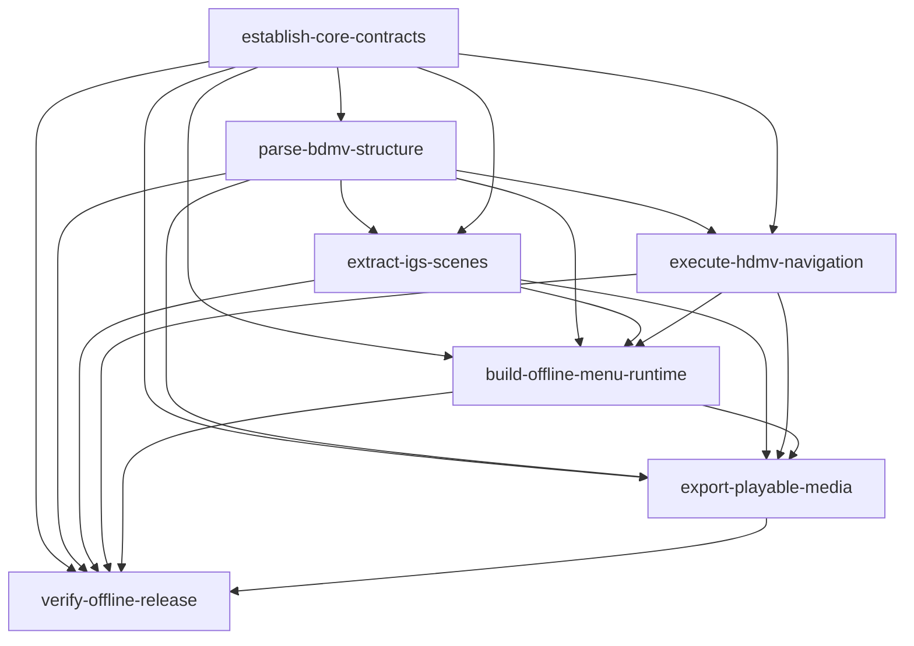

# HDMV 离线 Web：change 依赖与实施顺序

本图依据仓库根目录的 `bdmv_hdmv_offline_web_architecture.md` 划分首期范围。箭头表示下游完成集成和验收前，必须取得上游已完成的契约及对应验收结果；接口稳定后可提前并行开发。这里记录 change 间的实施依赖，与 OpenSpec 每个 change 内 proposal → specs/design → tasks 的工件依赖不同；OpenSpec CLI 的工件状态不会自动强制执行本图。

| Change | 对应阶段 | 直接前置 | 交付边界 |
| --- | --- | --- | --- |
| `establish-core-contracts` | M0 | 无 | 工作区、安全读取、版本化 IR、时间和诊断契约 |
| `parse-bdmv-structure` | M1 | core | 入口、结构和引用图；BD-J 标记不支持 |
| `extract-igs-scenes` | M2 | core、结构 | TS/PES、IGS、场景与无损图形 |
| `execute-hdmv-navigation` | M3 | core、结构 | 指令、寄存器、状态机与 trace；可与 M2 并行 |
| `build-offline-menu-runtime` | M4 | core、结构、IGS、VM | 无服务菜单和明确为 partial 的 menu-only |
| `export-playable-media` | M5 | core、结构、IGS、VM、菜单运行时 | 可达媒体、时间轴、播放反馈与 standalone-full |
| `verify-offline-release` | M6 | 上述全部 | 完整度判定、对照证据、浏览器矩阵与发布门槛 |

推荐顺序为 M0 → M1 →（M2 ∥ M3）→ M4 → M5 → M6。每项测试与诊断随对应 change 交付；M6 负责跨模块及发布验收，并不替代前置模块的测试。M4 的 menu-only 不能算作完整播放交付；M5 的功能也须经 M6 的实际浏览器矩阵验证后才能宣布 complete。

这组 change 不包含未来 M7 的 BD-J 执行。可达但不支持的 BD-J、操作码、媒体或效果必须保留诊断；strict 下不得标记为完整成功。浏览器版本、轨道/字幕支持范围等按架构文档在实施与验收时以证据锁定，无法支持或尚未验证时明确报告，不能假定通过。
