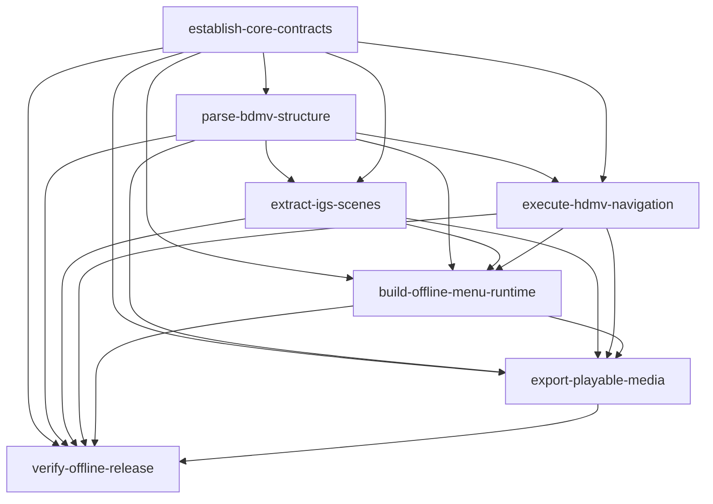

# HDMV 离线 Web：change 依赖与实施顺序

本图依据`docs/archive/bdmv_hdmv_offline_web_architecture.md`（初版架构方案） 划分首期范围。箭头表示下游完成集成和验收前，必须取得上游已完成的契约及对应验收结果；接口稳定后可提前并行开发。这里记录 change 间的实施依赖，与 OpenSpec 每个 change 内 proposal → specs/design → tasks 的工件依赖不同；OpenSpec CLI 的工件状态不会自动强制执行本图。

各阶段规范、官方资料、固定 revision 的参考源码及获取条件见 [开发参考索引](../../docs/references/README.md)。

| Change | 对应阶段 | 直接前置 | 交付边界 |
| --- | --- | --- | --- |
| `establish-core-contracts` | M0 | 无 | 工作区、安全读取、版本化 IR、时间和诊断契约 |
| `parse-bdmv-structure` | M1 | core | 入口、结构和引用图；BD-J 标记不支持 |
| `extract-igs-scenes` | M2 | core、结构 | TS/PES、IGS、场景与无损图形 |
| `execute-hdmv-navigation` | M3 | core、结构 | 指令、寄存器、状态机与 trace；可与 M2 并行 |
| `build-offline-menu-runtime` | M4 | core、结构、IGS、VM | 无服务菜单及可替换的影片动作桥 |
| `export-playable-media` | M5 | core、结构、IGS、VM、菜单运行时 | 可达 M2TS 映射和系统默认程序交接 |
| `verify-offline-release` | M6 | 上述全部 | 完整度判定、对照证据与发布门槛 |

推荐顺序为 M0 → M1 →（M2 ∥ M3）→ M4 → M5 → M6。每项测试与诊断随对应 change 交付；M6 负责跨模块及发布验收，并不替代前置模块的测试。统一产物的影片交接须经 M6 在默认关联程序环境中实际验证后才能宣布 complete，验收不限定操作系统。

这组 change 不包含未来 M7 的 BD-J 执行。可达但不支持的 BD-J、操作码、媒体或效果必须保留诊断；strict 下不得标记为完整成功。轨道/字幕支持范围按架构文档在实施与验收时以证据锁定，无法支持或尚未验证时明确报告，不能假定通过。

## 交接门槛与开发入口

跨模块契约和产品缺省值统一见 [IMPLEMENTATION_BASELINE.md](IMPLEMENTATION_BASELINE.md)，2026-11-02 的实施前充分性评估见 [readiness-review-2026-11-02.md](../../docs/archive/readiness-review-2026-11-02.md)。各 change 的 proposal 已说明实际影响模块，design 说明决策与异常，specs 定义可观察行为，tasks 给出实施和验证。

| 门槛 | 必须取得的证据 | 允许开始的后续工作 |
| --- | --- | --- |
| M0 契约交接 | 最小 IR/schema、时间/诊断/事件、Cursor/路径/事务正反例、工具链与 fixture | M1 实现；M2–M5 可编写消费方与模拟测试 |
| M1 结构交接 | ParsedDisc、原始命令/源偏移、轨道/引用图与 BACKUP 测试 | M2 流/IG 与 M3 VM 正式并行实施 |
| M2/M3 行为交接 | 场景/PNG/按钮原始命令；统一 decoder、VM/trace/导航边 | M4 菜单集成及 M5 媒体计划开发 |
| M4 预览交接 | 断网直接打开、真实菜单交互、unavailable 不挂死 | M5 替换媒体桥并验证完整播放链路 |
| M5 媒体交接 | 目标 M2TS 映射、系统打开交接、失败处理与真实环境证据 | M6 完整发布验收；不得提前宣称 complete |
| M6 发布门槛 | A–I 适用场景、独立参考与场景证据全部通过 | 才能发布 complete 包；其它要求缺席仍为未验证 |

M1 结构图并非完整导航图：M3 提供 MovieObject 边，M2 的按钮命令再交同一 M3 分析器补边，M5 计算保守媒体闭包。M3 使用合成按钮单测，不反向依赖 M2。sound 在 M1 解析、M4 输出 WAV；影片字幕由外部播放器负责。M6 的模板与回归框架可提前建立，不必等全部业务完成才开始准备。
